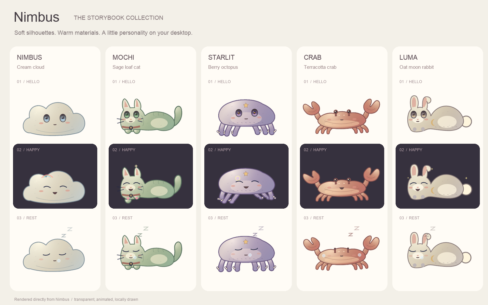

# Nimbus (灵霓) 🌌

Nimbus（中文名：灵霓）是一款采用 Rust 语言编写、基于 Wgpu + TinySkia 硬件加速渲染的**透明、可交互二次元卡通桌宠**。

它不仅仅是一个漂浮在屏幕底部的精美卡通云朵，更是一个**拥有隐私安全记忆系统**的本地智能伴侣。它由本地 MiniCPM/Llama 大模型推理引擎驱动，能够根据前台应用、时间、天气、成长记忆和真实身体触摸，自主生成启动问候、触摸回应、自言自语、梦话及设置变化后的反馈，并以连续动画呈现行为状态。

---

## ✨ 核心特性

- **🎨 14维参数化混合变形 (Blend-Shape) 引擎**：彻底告别传统逐帧动画或生硬的条件状态跳变。通过 14 个连续的数学浮点参数控制眼睑曲线、瞳孔缩放、嘴型、体态和震颤，使表情过渡实现帧率无关的丝滑渐变。
- **🧠 9 种连续行为状态 + 模型行为事件层**：
  - **常规待机 (Idle)**：常规眨眼，亮晶晶的大眼睛跟随鼠标旋转。
  - **抚摸贴贴 (Tickled)**：鼠标触碰小云朵，眼睛弯成月牙笑眼 `^ ^`，咧嘴大笑，伴随羞涩红晕。
  - **受惊失控 (Surprised)**：快速掠过或拖拽松手，双眼瞪圆呈 shocked 白瞳，大张嘴并伴随 **85Hz 高频全身抖动**。
  - **流式思考 (Thinking)**：眼睛紧闭，身体随呼吸轻微左右起伏摇晃。
  - **自言自语 (Muttering)**：说话输出时，嘴巴根据正弦波幅一张一合进行动态咬字。
  - **专注工作 (Working)**：检测到主人前台使用 IDE 或 Terminal 时，眼神专注，小撇嘴歪向一侧。
  - **深夜疲劳 (Tired)**：深夜无眠时，眼皮半耷拉，神态惺忪困倦。
  - **挂机发呆 (Bored)**：挂机超过 90 秒，眼皮切平呈无神“死鱼眼”并开始张嘴打哈欠。
  - **深度休眠 (Sleeping)**：释放显存后，双眼闭合，嘴挂**呼吸半透明口水泡**，头顶不断浮现淡出的 **"zZ" 气泡**。
- **👁️ 全局盯视与眼神跟随**：无论鼠标是在桌宠窗口内，还是在屏幕上的任何其它区域（如您正在写代码），桌宠的眼神都会智能投影并精准追随鼠标。不同的状态会分配不同的“精力跟随度”（如 Working 下 75% 瞄着鼠标，Bored 下 40% 眼神涣散）。
- **🫳 真实身体命中与点击穿透**：透明窗口边缘不参与触摸、唤醒或拖拽；只有渲染出的宠物身体遮罩会接收交互，其余透明区域会把点击交还给后方应用。
- **🧠 模型行为调度与成长**：每类事件使用独立 prompt，结合当前形态、性格、天气、应用和近期表达。重复、错形态或自我介绍式输出会触发最多两次短事件重试，只有模型不可用或连续生成不合格时才使用本地兜底。
- **⚡ 低功耗短句推理与紧凑窗口**：自主行为使用 512-token context、128-token micro-batch，并在短时间内复用上下文；静止时渲染约 8 FPS，全局鼠标移动、触摸、生成和状态过渡期间自适应提升到 30 FPS。宠物窗口按形态使用紧凑固定包围盒，气泡按真实文字行盒、边框、尾巴和阴影动态定尺，不用大块透明画布占位。
- **🎭 五种活体形态**：云朵、抹茶猫、星光章鱼、红螯螃蟹与月灯兔拥有各自的身体轮廓、呼吸节奏、附肢动作和触摸反馈；尾巴、触手、大螯、长耳等实体附肢都参与真实本体命中判定，装饰粒子保持穿透。
- **🔒 隐私安全本地习惯记忆**：桌宠会通过轮询前台进程名称记录您的常用软件习惯（完全本地持久化保存在 `~/.nimbus_memory.json`，绝不上报，无键盘点击监控），并在菜单中提供“记忆日记”详情，展现与主人的日常陪伴画像。
- **⚙️ AppleScript 原生集成**：支持通过 macOS 原生输入框一键为桌宠起一个艺术性的名字。

---

## 🚀 快速开始

### 依赖项
确保您的 macOS 上已安装 `Rust` 工具链（包含 `cargo`）、`Python 3`（启动与部署脚本使用）以及 `Metal` 运行环境（M1/M2/M3 芯片可完美支持硬件加速）。

### 编译与启动
项目提供了一键编译部署脚本。在项目根目录下执行：

```bash
# 以前台终端交互模式启动（可直接在终端中打字与桌宠对话）
./run.sh

# 以后台守护进程模式启动（静默运行，交互全靠托盘与桌面悬停）
./run.sh --daemon
```

*脚本遵从已有代理环境，先编译并验证 Release 产物，再停止旧实例。编译失败时保留当前运行的桌宠。可从任意目录调用脚本。*

### 绘本玩偶视觉

五种角色采用统一的哑光玩偶材质：奶油云朵、鼠尾草猫、莓紫章鱼、陶土螃蟹与燕麦兔。柔和轮廓、局部冷暖明暗、布片缝线与玻璃珠眼睛共同表达体积；表情和附肢继续随待机、触摸、工作和睡眠状态变化。




### 第一次使用

无需模型即可触摸、拖动桌宠和切换外观。菜单栏云朵图标提供 **和桌宠说句话…**、**查看完整消息…** 与 **使用帮助…**，后台模式也能聊天。关闭 **主动说话（含梦话）** 后，桌宠停止新的自主发言，仍可回应主动互动。

自由对话需要本机已有的兼容 GGUF 模型。在 `~/.nimbus_config.toml` 中填写模型的绝对路径并重启：

```toml
model_path = "/absolute/path/to/model.gguf"
```

可参考 [config.example.toml](config.example.toml)，只填需要覆盖的设置；不要用示例覆盖已有配置。菜单会显示模型文件是否已配置；模型未配置或无回复时，气泡会给出下一步提示。不同 GGUF 的聊天模板兼容性需以实际模型验证。

长消息会在气泡内显示摘要与完整消息提示；全文保留在内存中，可从托盘重读。原生输入框和记忆查看在后台线程运行，打开时桌宠仍能绘制。

### 数据与运行

- 配置位于 `~/.nimbus_config.toml`，应用使用习惯与成长记忆位于 `~/.nimbus_memory.json`；均在本机保存。
- 前台应用名称与小时每 45 秒采样一次，不采集键盘输入；当前尚无暂停采样开关。清空记忆会同时清空模型聊天上下文，但之后仍继续记录。
- 文件通过临时文件和原子替换保存。遇到不可解析的文件时保留原文件，后续保存前留存 `.invalid` 备份；无法安全保存时输出错误，不静默丢弃原数据。
- `./deploy.sh` 安装登录启动服务，`./deploy.sh status` 查看状态，`./deploy.sh uninstall` 卸载。正常退出不自动重启，异常退出由 launchd 拉起。
- 天气外观来自手动设置，并非联网实时天气。

---

## 📁 项目结构

```
nimbus-pet/
├── src/
│   ├── main.rs            # Winit 事件循环、Wgpu视口、智能状态决策级联
│   ├── behavior.rs        # 模型行为事件、prompt、质量过滤、去重与自然频率抖动
│   ├── state.rs           # 带迟滞的稳定状态机
│   ├── activity.rs        # 前台应用与时间观察
│   ├── renderer.rs        # 14维参数化贝塞尔曲面混合变形渲染器
│   ├── llama_engine.rs    # Llama/Qwen 大模型单进程极速推理引擎
│   ├── memory.rs          # ~/.nimbus_memory.json 本地隐私习惯记忆库
│   ├── think_filter.rs    # 思考标记深度过滤器
│   └── config.rs          # 运行配置文件与人设持久化
├── run.sh                 # 一键杀死/编译/部署后台守护进程脚本
└── Cargo.toml             # Rust 依赖包声明
```

---

## 📖 技术实现深度文档
关于 **14维混合变形参数公式**、**双曲线贝塞尔眼睑模型数学推导** 以及 **级联决策算法**，请参阅独立的深度技术文档：  
👉 [Nimbus 技术实现与架构设计 (TECHNICAL.md)](TECHNICAL.md)
